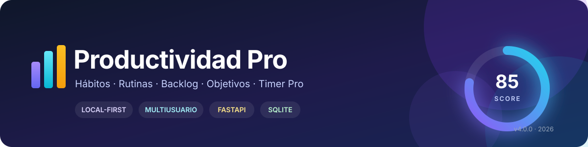
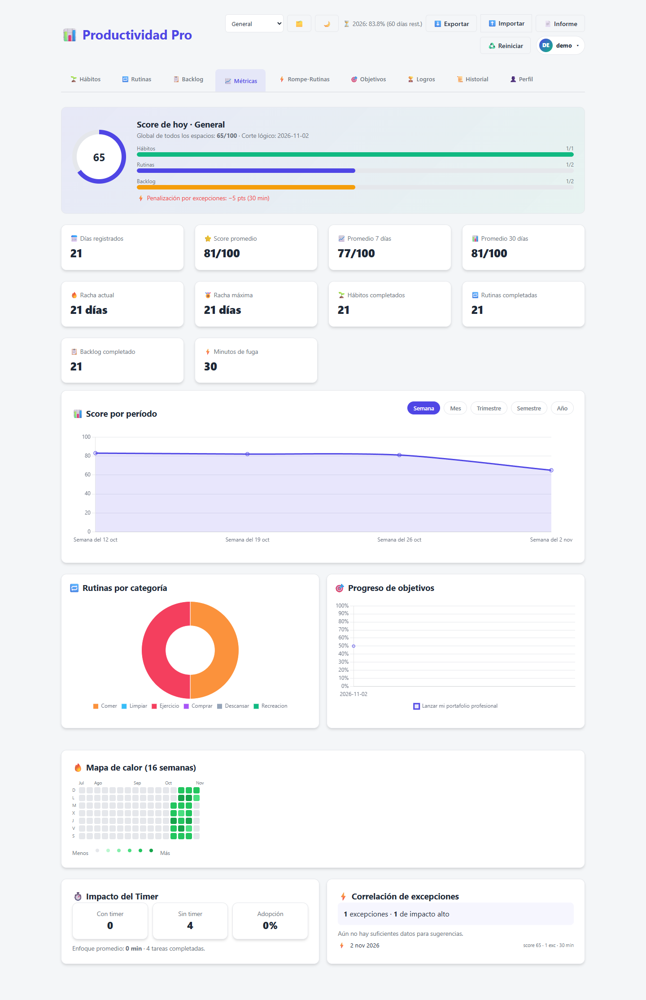
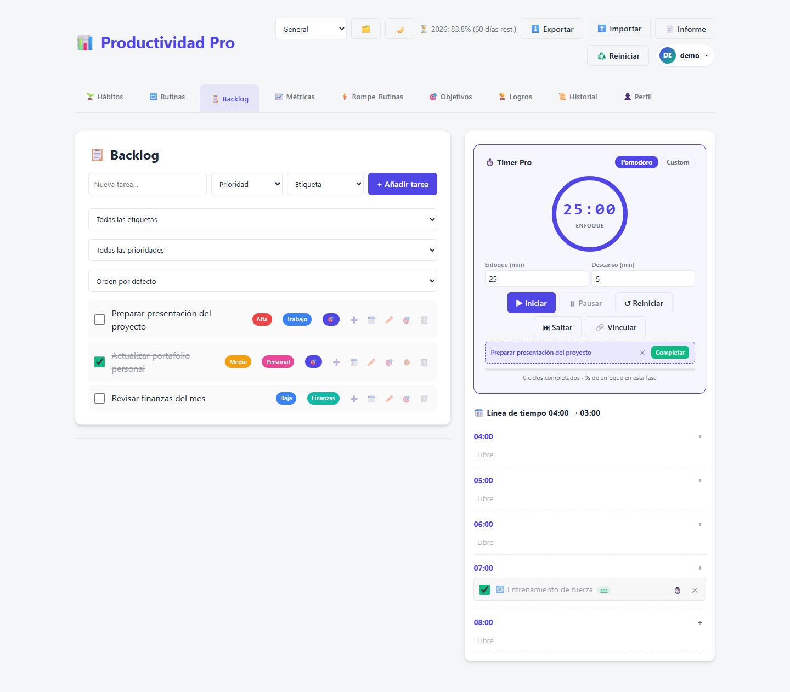
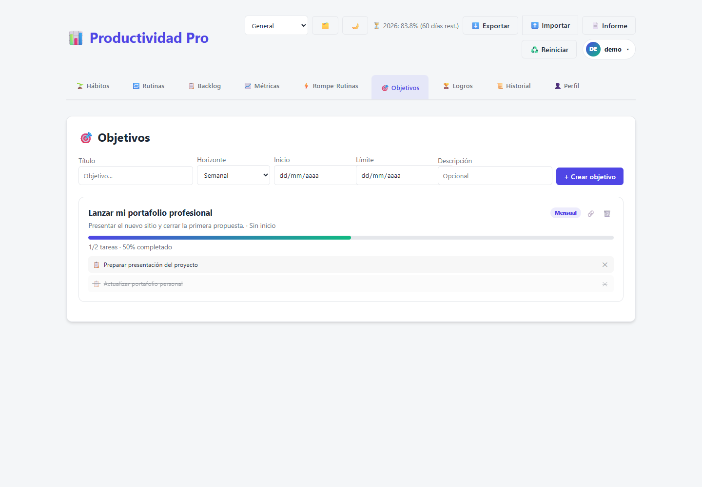
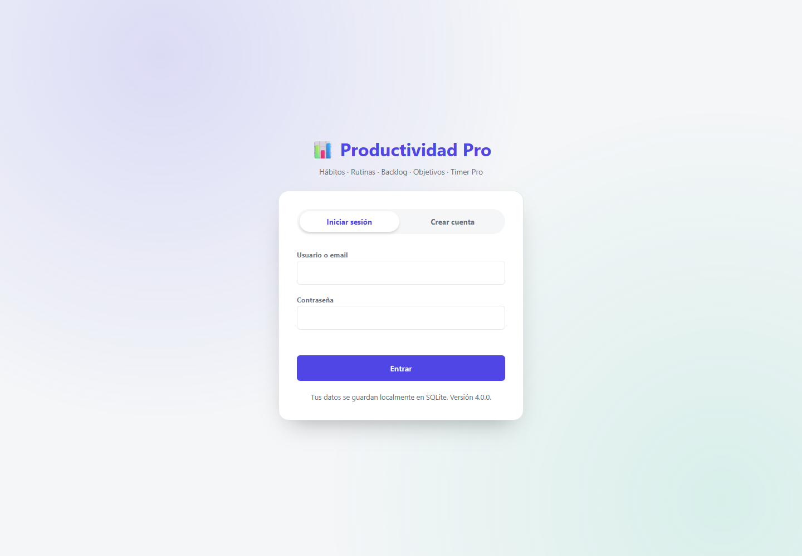
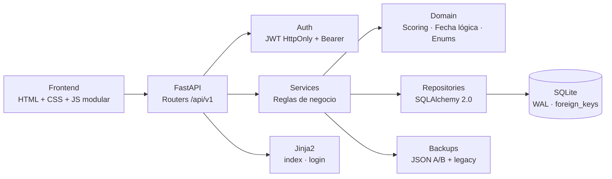

<div align="center">
  

  <h1>Productividad Pro</h1>

  <p><strong>Tu sistema personal de productividad, local-first y multiusuario.</strong></p>

  <p>
    Hábitos · Rutinas · Backlog · Objetivos · Pomodoro · Analítica
  </p>

  <p>
    
    
    
    
    
    
  </p>

  <p>
    <a href="#-inicio-rápido"><strong>Inicio rápido</strong></a> ·
    <a href="#-capturas"><strong>Capturas</strong></a> ·
    <a href="#-arquitectura"><strong>Arquitectura</strong></a> ·
    <a href="#-api"><strong>API</strong></a> ·
    <a href="#-licencia"><strong>Licencia</strong></a>
  </p>
</div>

---

> [!IMPORTANT]
> **Licencia privativa.** Este repositorio es público únicamente para visualización,
> demostración y evaluación. **No es software de código abierto** y no concede permiso
> para copiar, modificar, redistribuir ni desplegar el proyecto. Consulta
> [LICENSE](LICENSE) antes de cualquier uso.

## ✨ ¿Qué es Productividad Pro?

**Productividad Pro** es una aplicación web completa para organizar el día, medir el
progreso real y mantener el foco. Nació como una migración de una app personal en un
solo HTML a una arquitectura **FastAPI + SQLite** con autenticación multiusuario,
persistencia real, backups y una interfaz fiel al diseño original.

No es un gestor de tareas más: combina **hábitos**, **rutinas**, **backlog**,
**objetivos**, **Pomodoro**, **excepciones de tiempo** y **analítica** en un único
sistema con reglas de negocio pensadas para el uso diario.

### Lo que hace diferente

- **Local-first de verdad**: tus datos viven en SQLite, dentro de tu máquina. Sin
  telemetría, sin servicios externos y sin dependencia de la nube.
- **Multiusuario con aislamiento estricto**: cada consulta filtra por `user_id`; un
  usuario no puede ver ni modificar los datos de otro.
- **Un score que refleja tu día**: pesos dinámicos por módulo, penalizaciones por
  fugas de tiempo y cortes lógicos a las 04:00.
- **Interfaz sin build**: HTML, CSS y JavaScript modular clásico. Chart.js se sirve
  localmente, así que la app funciona incluso sin conexión.
- **Datos portables**: exportación JSON, importación de backups legacy v1/v2/v3,
  backups rotativos A/B y restauración desde la propia interfaz.

## 📸 Capturas

<p align="center">
  
</p>

| Backlog + Timer Pro | Objetivos |
|:---:|:---:|
|  |  |

<details>
<summary><strong>Ver pantalla de acceso</strong></summary>
<br>
<p align="center">
  
</p>
</details>

> Las capturas usan una cuenta y datos de demostración. No contienen información real.

## 🚀 Inicio rápido

**Requisitos:** Python 3.11 o superior. Probado con Python 3.13 en Windows.

```bash
git clone https://github.com/angelgasv29/productividad-pro.git
cd productividad-pro

python -m venv .venv
```

**Windows (PowerShell):**

```powershell
.\.venv\Scripts\Activate.ps1
pip install -r requirements.txt
python run.py
```

**Linux / macOS:**

```bash
source .venv/bin/activate
pip install -r requirements.txt
python run.py
```

Abre <http://127.0.0.1:8000> y crea tu cuenta. La base de datos se inicializa sola
en `data/productividad_pro.db` con WAL, `foreign_keys=ON`, `busy_timeout=5000` y
`synchronous=NORMAL`.

Opciones útiles:

```bash
python run.py --host 0.0.0.0 --port 8080
python run.py --reload
```

### Configuración mínima para producción

Copia `.env.example` a `.env` y cambia, como mínimo, la clave secreta:

```dotenv
SECRET_KEY=una-clave-larga-aleatoria-y-unica
COOKIE_SECURE=true
```

> `COOKIE_SECURE=true` requiere HTTPS. Si vas a ejecutar la app en local sin TLS,
> déjalo en `false`.

## 🧠 Funcionalidades

| Módulo | Qué incluye |
|---|---|
| 🌱 **Hábitos** | Árboles recursivos, subtareas, cascada de completado, días de la semana y periodos. |
| 🔁 **Rutinas** | Categorías (Comer, Limpiar, Ejercicio, Comprar, Descansar, Recreación), repetición y logros. |
| 📋 **Backlog** | Prioridades, etiquetas, agenda por horas, tareas únicas o recurrentes y archivo de completadas. |
| 🎯 **Objetivos** | Horizontes semanal → anual, vínculo único por tarea, progreso e histórico con `spanGaps`. |
| ⏱️ **Timer Pro** | Pomodoro persistente, pausa/reanudación, guardado parcial, vínculo con tareas y sin auto-inicio. |
| ⚡ **Rompe-Rutinas** | Registro de fugas de tiempo con impacto Alta/Leve y penalización proporcional. |
| 📈 **Métricas** | Score diario, rachas, promedios, mapa de calor de 16 semanas, categorías e impacto del timer. |
| 📜 **Historial** | 7 períodos (día → año), detalle por día, exportación CSV/TXT y fallback legacy. |
| 🏆 **Logros** | Archivo diario de hábitos/rutinas completados y backlog purgado, con exportación CSV. |
| 💾 **Backups** | Exportación JSON, importación atómica, slots A/B, backup previo a reset y restauración. |
| 👤 **Cuentas** | Registro, login, perfil, tema claro/oscuro, cambio de contraseña y baja de cuenta. |
| 🗂️ **Espacios** | Espacios de trabajo independientes con score propio y score global sin solapamiento. |

### Reglas de negocio destacadas

- **Fecha lógica:** el día cambia a las **04:00**, no a medianoche. La línea de tiempo
  va de 04:00 a 03:00.
- **Score:** `Hábitos 40% + Rutinas 40% + Backlog 20%`. Los módulos vacíos se
  redistribuyen; si todo está vacío, el score es `0`.
- **Penalizaciones:** Alta = 5 pts / 30 min; Leve = 2 pts / 30 min. Si una fuga cruza
  las 04:00, se reparte entre los dos días lógicos.
- **Cascada:** completar una hoja recalcula sus padres. Añadir una subtarea a un padre
  completado lo desmarca y elimina sus logros.
- **Reset diario:** archiva logros, reinicia hábitos/rutinas, purga raíces completas de
  Backlog, limpia la agenda única y rellena huecos del historial.
- **Timer:** el tiempo se guarda de forma parcial; al terminar una fase **no** se inicia
  automáticamente la siguiente.

<details>
<summary><strong>Ver el detalle completo de las reglas</strong></summary>

<br>

#### Fecha lógica

- Entre las 00:00 y las 03:59 se sigue contando el día anterior.
- A las 04:00 comienza el nuevo día lógico.
- La línea de tiempo muestra 24 bloques: `04:00, 05:00, …, 23:00, 00:00, …, 03:00`.
- Los intervalos que cruzan el corte se reparten entre ambos días.

#### Score

```text
base = hábitos * 0.40 + rutinas * 0.40 + backlog * 0.20
```

- Los módulos sin elementos se eliminan y su peso se reparte entre los restantes.
- Si los tres módulos están vacíos, el score es **0**.
- Se guarda por espacio y global en filas independientes (`scope_key`), sin que uno
  pise al otro.
- El score final nunca baja de 0.

#### Árbol y cascada

- Solo las hojas se pueden marcar directamente; el checkbox del padre está deshabilitado.
- Completar una hoja recalcula los padres de abajo hacia arriba.
- Añadir una subtarea a un padre completado lo desmarca y elimina logros asociados.
- Desmarcar una tarea elimina sus logros.
- Las subtareas heredan el espacio de trabajo del padre.
- Archivar un Backlog completado lo purga del árbol y de la agenda; los hábitos/rutinas
  completados generan logros diarios.

#### Reset diario

1. Rescata un timer en marcha (guardado parcial).
2. Crea un backup de emergencia.
3. Archiva logros de hábitos/rutinas y raíces de Backlog completadas.
4. Reinicia hábitos y rutinas.
5. Limpia la agenda de asignaciones únicas.
6. Rellena días faltantes del historial.
7. Reinicia el timer sin auto-iniciar la siguiente fase.

#### Timer

- Estado persistente en `active_timer_states`.
- El tiempo se recorta a `remaining_secs` para evitar regalar horas si se olvida una pestaña.
- El trabajo se registra por día lógico; un intervalo que cruza las 04:00 se reparte.
- Al terminar una fase **no se inicia automáticamente** la siguiente.

#### Objetivos

- Una tarea solo puede pertenecer a un objetivo (`unique` en `objective_task_links.node_id`).
- El progreso se guarda por día; el gráfico usa `spanGaps: true`.
- Si se elimina una tarea, su vínculo queda como “eliminada” hasta limpiarlo.

</details>

## 🏗️ Arquitectura



**Clean / Hexagonal en la práctica:**

- Los **routers** solo orquestan HTTP y validan DTOs.
- La lógica de negocio vive en **services** y **domain**.
- Los **repositories** son la única capa que toca SQLAlchemy.
- Los modelos usan `Mapped` / `mapped_column` de SQLAlchemy 2.0.
- Los schemas usan Pydantic v2 (`model_config`, `field_validator`, `model_validator`).
- Las migraciones se gestionan con **Alembic** (`render_as_batch=True` para SQLite).

### Estructura del proyecto

```text
productividad_pro/
├── app/
│   ├── api/
│   │   ├── deps.py
│   │   └── v1/
│   │       ├── auth.py          # registro, login, logout
│   │       ├── users.py         # perfil, contraseña, baja
│   │       ├── workspaces.py    # CRUD de espacios
│   │       ├── nodes.py         # hábitos, rutinas y backlog
│   │       ├── schedule.py      # timeline 04:00 → 03:00
│   │       ├── timer.py         # Timer Pro
│   │       ├── exceptions.py    # Rompe-Rutinas
│   │       ├── objectives.py    # objetivos e historial
│   │       ├── achievements.py  # logros + CSV
│   │       ├── analytics.py     # métricas, heatmap, historial
│   │       ├── system.py        # salud, backups, restore, selftest
│   │       ├── backup.py        # export/import JSON
│   │       └── router.py
│   ├── core/                    # config, database, security, errores
│   ├── domain/                  # enums, fecha lógica, scoring puro
│   ├── models/                  # SQLAlchemy 2.0
│   ├── repositories/            # acceso a datos por user_id
│   ├── schemas/                 # Pydantic v2
│   ├── services/                # reglas de negocio
│   └── main.py
├── static/
│   ├── css/styles.css
│   ├── js/{api,state,render,analytics,timer,main,login}.js
│   └── vendor/chart.umd.min.js
├── templates/{index,login}.html
├── alembic/
│   ├── env.py
│   ├── script.py.mako
│   └── versions/0001_initial.py
├── docs/                        # banner y capturas
├── data/                        # runtime: DB y backups (ignorados por git)
├── tests/
├── alembic.ini
├── requirements.txt
├── run.py
├── .env.example
├── LICENSE
└── README.md
```

## 🔐 Seguridad y privacidad

- **Contraseñas** con Argon2/Bcrypt mediante `pwdlib`.
- **JWT HS256** en cookie `HttpOnly` y también compatible con `Authorization: Bearer`.
- **Multi-tenancy estricto**: todas las consultas de datos incluyen `user_id`; los IDs
  se validan contra el usuario antes de modificar.
- **Importación atómica** dentro de un savepoint: si falla, tus datos actuales quedan
  intactos.
- **Sin telemetría** ni llamadas a servicios externos para el funcionamiento normal.
- **Datos fuera de Git**: `data/*.db`, `data/backups/*` y `.env` están en `.gitignore`.

> Cambia siempre `SECRET_KEY` antes de exponer la app fuera de tu máquina.

## ⚙️ Configuración

| Variable | Por defecto | Descripción |
|---|---|---|
| `SECRET_KEY` | clave local de desarrollo | Firma HS256 de los JWT. **Cámbiala en producción.** |
| `DATABASE_URL` | `sqlite:///data/productividad_pro.db` | URL SQLAlchemy. |
| `ACCESS_TOKEN_EXPIRE_MINUTES` | `10080` (7 días) | Duración de la sesión. |
| `COOKIE_SECURE` | `false` | Ponlo en `true` detrás de HTTPS. |
| `COOKIE_SAMESITE` | `lax` | `lax`, `strict` o `none`. |
| `LOGICAL_CUTOFF_HOUR` | `4` | Hora de corte lógico por defecto. |
| `MAX_IMPORT_BYTES` | `26214400` | Límite de importación (25 MB). |
| `DEBUG` | `false` | Modo de depuración. |

## 🧪 Tests

```bash
pytest -q
```

Resultado actual:

```text
23 passed, 1 warning
```

La suite usa una base SQLite temporal y un directorio de backups temporal; **nunca**
toca tu base real. Incluye pruebas de:

- aislamiento de usuarios;
- corte lógico antes/después de las 04:00;
- cascada de 3 niveles y reversión al añadir subtareas;
- scores por espacio y global sin solapamiento;
- importación legacy atómica;
- endpoints principales, exportaciones y backups.

El único warning es una deprecación de Starlette/httpx en el entorno de tests; no
afecta al funcionamiento de la aplicación.

## 🔌 API

Base: `/api/v1`. Autenticación por cookie o `Authorization: Bearer <token>`.
Documentación interactiva: <http://127.0.0.1:8000/docs>.

| Grupo | Rutas principales |
|---|---|
| Autenticación | `POST /auth/register`, `POST /auth/login`, `POST /auth/logout` |
| Usuario | `GET /users/me`, `PATCH /users/profile`, `POST /users/change-password`, `DELETE /users/account` |
| Espacios | `GET/POST /workspaces`, `PATCH/DELETE /workspaces/{id}`, `POST /workspaces/{id}/select` |
| Árboles | `GET/POST /nodes`, `PATCH/DELETE /nodes/{id}`, `POST /nodes/{id}/toggle`, `POST /nodes/{id}/archive` |
| Agenda | `GET /schedule/timeline`, `GET /schedule/suggestion`, `POST /schedule/assign`, `DELETE /schedule/{slot}` |
| Timer | `GET /timer/state`, `POST /timer/{start,pause,reset,skip,link,unlink,complete-task}` |
| Excepciones | `GET/POST /exceptions`, `DELETE /exceptions/{id}` |
| Objetivos | `GET/POST /objectives`, `PATCH/DELETE /objectives/{id}`, `POST /objectives/{id}/link` |
| Logros | `GET /achievements`, `GET /achievements/export.csv` |
| Analítica | `GET /analytics/bootstrap`, `today-score`, `global-stats`, `heatmap`, `timer-impact`, `correlation`, `categories`, `history`, `history/export.csv`, `report.txt`, `year-countdown` |
| Sistema | `GET /system/health`, `POST /system/backup`, `POST /system/restore/{A\|B}`, `POST /system/reset`, `POST /system/selftest` |
| Backups | `GET /backup/export`, `POST /backup/import`, `GET /backup/slots` |

<details>
<summary><strong>Ver tabla completa de endpoints</strong></summary>

<br>

| Método | Ruta | Descripción |
|---|---|---|
| POST | `/auth/register` | Crear cuenta (crea espacios por defecto). |
| POST | `/auth/login` | Iniciar sesión; set-cookie HttpOnly. |
| POST | `/auth/logout` | Cerrar sesión. |
| GET | `/users/me` | Usuario actual. |
| PATCH | `/users/profile` | Email, tema, corte lógico, Pomodoro, espacio actual. |
| POST | `/users/change-password` | Cambiar contraseña. |
| DELETE | `/users/account` | Eliminar cuenta y datos (backup previo). |
| GET/POST | `/workspaces` | Listar/crear espacios. |
| PATCH/DELETE | `/workspaces/{id}` | Renombrar/eliminar. |
| POST | `/workspaces/{id}/select` | Seleccionar espacio actual. |
| GET | `/nodes?module_type=habits` | Árbol del módulo. |
| GET | `/nodes` | Los tres árboles. |
| GET | `/nodes/pending` | Hojas pendientes. |
| POST | `/nodes` | Crear tarea o subtarea. |
| PATCH | `/nodes/{id}` | Editar título, días, periodo, categoría, prioridad, etiqueta, objetivo. |
| POST | `/nodes/{id}/toggle` | Completar/descompletar con cascada. |
| POST | `/nodes/{id}/archive` | Archivar como logro. |
| DELETE | `/nodes/{id}` | Eliminar subárbol. |
| GET | `/schedule/timeline` | Línea de tiempo del día lógico. |
| GET | `/schedule/suggestion` | Tarea pendiente de la hora actual. |
| POST | `/schedule/assign` | Agendar tarea (recurrente o única). |
| DELETE | `/schedule/{slot}` | Omitir por hoy o eliminar asignación única. |
| GET | `/timer/state` | Estado actual del timer. |
| POST | `/timer/start` | Iniciar/reanudar (incluye descanso). |
| POST | `/timer/pause` | Pausar/avanzar fase. |
| POST | `/timer/reset` | Reiniciar fase de trabajo. |
| POST | `/timer/skip` | Saltar fase sin auto-inicio. |
| POST | `/timer/link` | Vincular tarea hoja pendiente. |
| POST | `/timer/unlink` | Desvincular. |
| POST | `/timer/complete-task` | Completar tarea vinculada. |
| GET/POST | `/exceptions` | Listar/crear fugas de tiempo. |
| DELETE | `/exceptions/{id}` | Eliminar y recalcular score histórico. |
| GET/POST | `/objectives` | Listar/crear objetivos. |
| PATCH/DELETE | `/objectives/{id}` | Editar/eliminar. |
| POST | `/objectives/{id}/link` | Vincular tarea. |
| DELETE | `/objectives/{id}/link/{node}` | Desvincular. |
| GET | `/objectives/history` | Historial de progreso. |
| GET | `/achievements` | Logros paginados (25 por defecto). |
| GET | `/achievements/export.csv` | CSV con `QUOTE_ALL`. |
| GET | `/analytics/bootstrap` | Carga inicial completa. |
| GET | `/analytics/today-score` | Score del espacio y global. |
| GET | `/analytics/global-stats` | Estadísticas y rachas. |
| GET | `/analytics/heatmap?weeks=16` | Mapa de calor. |
| GET | `/analytics/timer-impact` | Impacto del timer. |
| GET | `/analytics/correlation` | Correlación y sugerencias. |
| GET | `/analytics/categories` | Rutinas por categoría. |
| GET | `/analytics/history?period=week` | Historial (7 períodos + fallback legacy). |
| GET | `/analytics/history/export.csv` | CSV del historial. |
| GET | `/analytics/report.txt` | Informe TXT. |
| GET | `/analytics/year-countdown` | Porcentaje y días restantes del año. |
| GET | `/system/health` | Conteos, tamaño de BD, backups. |
| POST | `/system/backup` | Rotar backup A/B. |
| POST | `/system/restore/{A\|B}` | Restaurar slot. |
| POST | `/system/reset` | Reiniciar datos del usuario. |
| POST | `/system/selftest` | Diagnóstico rápido. |
| GET | `/backup/export` | Descargar JSON completo. |
| POST | `/backup/import` | Importar JSON legacy o nuevo. |
| GET | `/backup/slots` | Metadatos de backups. |

</details>

## 💾 Backups y portabilidad

- **Exportar**: menú superior → `⬇️ Exportar` o `GET /api/v1/backup/export`.
- **Importar**: `⬆️ Importar` acepta el JSON nuevo (`schemaVersion: 4`) y los formatos
  legacy v1/v2/v3.
- La importación se ejecuta dentro de un **savepoint**: si falla, tus datos actuales
  quedan intactos.
- Los IDs legacy se remapean a UUID nuevos para evitar colisiones entre usuarios.
- El servidor rota `data/backups/user_{id}_slotA.json` y `slotB.json`.
- Antes de un reset se guarda `user_{id}_pre_reset.json`.

Consola del navegador (con la sesión iniciada):

```js
await appHealth();          // estado de la base de datos
await restoreBackup('A');   // restaurar el slot A
await runTests();           // autodiagnóstico
```

## 🧭 Estado del proyecto

- **Versión:** `4.0.0`
- **Estado:** estable y usable en local.
- **Enfoque actual:** robustez de datos, analítica y experiencia de uso diario.
- **Ideas futuras:** contenedor Docker, soporte PostgreSQL, PWA instalable y más
  exportaciones. No son compromisos de entrega.

## 🤝 Contribuciones

Este es un proyecto **privativo**. Las sugerencias, reportes de bugs e ideas son
bienvenidos a través de GitHub Issues, pero **no se aceptan contribuciones de código
sin autorización previa por escrito** del titular. Consulta [LICENSE](LICENSE).

## 📄 Licencia

**Privativa / All rights reserved.** Copyright © 2026 Angel Villegas.

El repositorio se publica para que puedas verlo, evaluarlo y aprender de su
arquitectura. No se concede permiso para reutilizar, modificar, redistribuir ni
desplegar el software sin autorización escrita. El texto completo está en
[LICENSE](LICENSE). Los componentes de terceros se rigen por sus propias licencias;
consulta [THIRD_PARTY_NOTICES.md](THIRD_PARTY_NOTICES.md).

---

<div align="center">
  <p>
    Hecho con foco por <a href="https://github.com/angelgasv29"><strong>Angel Villegas</strong></a>
  </p>
  <p>
    <sub>Productividad Pro · v4.0.0 · 2026</sub>
  </p>
</div>
